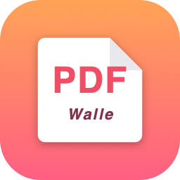

<div align="center">



# WallePDFReader

最简洁的 macOS 原生 PDF 阅读器 · 多 Tab · 断点续读

</div>

## 安装

[**↓ 下载最新版 DMG**](https://github.com/sangwf/WallePDFReader/releases/latest)

1. 双击 `.dmg` 挂载
2. 把 `WallePDFReader.app` 拖到 `Applications` 文件夹（旁边的快捷方式）
3. **第一次打开**：在 Finder 里**右键 `WallePDFReader.app` → 打开**，弹窗里再点「打开」
   - macOS Gatekeeper 要求绕过，因为这是开发者本地签名版本（没有付费 Apple Developer 证书）
   - 之后双击就能正常用

## 功能

- **多 Tab** — 类 Chrome 的 tab 栏，`+` 按钮紧跟最后一个 tab
- **多种打开方式** — 拖入 / 点击首页 / `⌘O` / 双击 PDF
- **断点续读** — 关掉再开自动跳到上次的页面与位置（每个文件单独记忆，存在 `~/Library/Application Support/WallePDFReader/`）
- **单窗口** — 双击其它 PDF 自动追加为新 tab，不再开多余窗口
- **区域截图**（v1.1）— `⌘⇧S` 进入截图模式，拖框选区，**双击选区直接复制**（仿微信），或者用 `[Copy] [Save…] [Cancel]` 浮窗操作；`Enter` 也是 Copy、`ESC` 取消。基于 PDF 矢量源渲染，输出永远清晰
- **可设为系统默认 PDF 应用**（见下）

底层渲染、缩放、滚动、文本选择全部交给 macOS 原生 `PDFKit`。所有功能零按钮，全部走菜单 + 快捷键，主界面始终干净。

## 设为默认 PDF 应用

```bash
swift Tools/SetDefault.swift
```

或在 Finder 里右键任意 PDF → 显示简介 (⌘I) → 展开「打开方式」→ 选 `WallePDFReader` → 「全部更改…」。

## 从源码构建

需要 Xcode 命令行工具（含 Swift 编译器）。

```bash
./build.sh                    # 编译 Swift + 打包成 WallePDFReader.app
./Tools/MakeDMG.sh            # 上面那步 + 打成可分发的 DMG
```

修改了图标设计想重新生成时：

```bash
rm Build/AppIcon.icns         # 删掉缓存
./build.sh                    # 自动重跑 Tools/MakeIcon.swift
```

## 项目结构

```
Sources/PDFReader.swift     SwiftUI App + PDFKit 整个应用（约 280 行）
Tools/MakeIcon.swift        Core Graphics 程序化生成 AppIcon
Tools/MakeDMG.sh            一键打 DMG
Tools/SetDefault.swift      设为系统默认 PDF 处理程序
Info.plist                  Bundle 元数据
build.sh                    编译 + 打包 .app
```

## 技术栈

SwiftUI + PDFKit。零第三方依赖，整个 .app 不到 1 MB。
